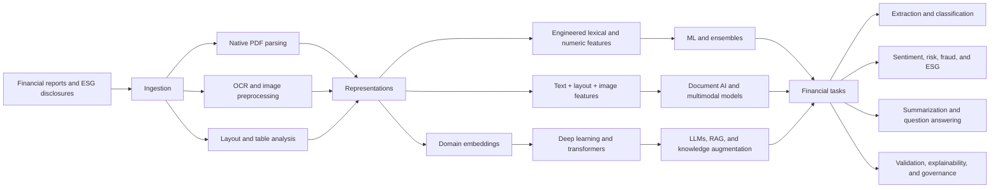

# Financial Report Extraction with NLP

## Research companion to a comprehensive FNLP review

This repository is the research companion to:

> Fawaz Khaled Alarfaj. **A Comprehensive Study on Automated Extraction from Financial Reports Using NLP Approaches.** *Arabian Journal for Science and Engineering* 51, 11843–11891 (2026). Published online 28 February 2026. [https://doi.org/10.1007/s13369-026-11157-6](https://doi.org/10.1007/s13369-026-11157-6)

**Read the paper:** [Springer Nature SharedIt full-text view][sharedit]

**Permanent citation link:** [https://doi.org/10.1007/s13369-026-11157-6](https://doi.org/10.1007/s13369-026-11157-6)

It turns the review's main findings into a navigable, citation-ready resource for researchers and practitioners working on financial natural language processing (FNLP), financial narrative processing (FNP), document AI, ESG analytics, and multilingual financial disclosure.

## At a glance

| Review dimension | Paper-reported result |
|---|---:|
| Studies in the final review corpus | 231 |
| Coverage window | 2018–2026 |
| Transformer-based studies | 93 (40.3%) |
| LLM-based studies | 39 (16.9%) |
| Largest application area | Financial sentiment and opinion mining: 52 (22.5%) |
| ESG and sustainability analytics | 43 (18.6%) |
| Information extraction from reports | 35 (15.2%) |

The paper follows the field from engineered features and ensemble learning through deep neural models, layout-aware transformers, large language models, retrieval-augmented generation, knowledge graphs, multimodal systems, and explainable AI. It gives particular attention to Arabic–English disclosures, Saudi Exchange (Tadawul) reporting, ESG analysis, and the objectives of Saudi Vision 2030.

## Explore the companion

- [Paper overview](docs/paper-overview.md) — purpose, contributions, research questions, and findings.
- [Review methodology](docs/review-methodology.md) — databases, query concepts, screening rules, and the 231-study corpus.
- [Paper map and traceability notes](docs/paper-map-and-traceability.md) — actual section locations, internal cross-reference cautions, and source boundaries.
- [Method taxonomy](docs/method-taxonomy.md) — classical ML, ensembles, deep learning, transformers/LLMs, multimodal and explainable approaches.
- [Tools and datasets](docs/tools-and-datasets.md) — practical selection criteria and resources discussed in the paper.
- [Arabic–English, ESG, and Saudi context](docs/arabic-english-esg-saudi-context.md) — regional motivation and research requirements.
- [Applications and research gaps](docs/applications-and-research-gaps.md) — use cases, limitations, and an evidence-aligned agenda.
- [Glossary](docs/glossary.md) — concise definitions of the paper's core terms.
- [Roadmap](ROADMAP.md) — the boundary between this documentation release and a later implementation phase.
- [Derived review summaries](data/README.md) — machine-readable aggregates transcribed from the paper.

## Method landscape

This diagram is an original companion synthesis. It is not a reproduction of a publisher figure.

## Scope and status

This release contains documentation, structured summaries, and citation metadata only.

- No trained model, model weights, executable pipeline, benchmark results, or production system are released here.
- No claim is made that the paper's reviewed methods have been reproduced by this repository.
- No publisher-formatted article or eProof PDF is included.
- The aggregate CSV files summarize facts reported in the paper; they are not a newly screened systematic-review database and do not contain 231 study-level records.
- The publication does not provide a study-level extraction sheet that maps all 231 included studies to citations and categories; this companion therefore does not claim study-level reproducibility.
- A working Python financial extraction implementation is intentionally reserved for a later phase.

## Suggested use

Use this companion to orient a literature review, design an FNLP evaluation plan, compare tool categories, or identify open research questions. For empirical claims, detailed study-level evidence, and the authoritative wording, cite and consult the published article.

## Citation

Please cite the paper rather than the companion alone. GitHub's **Cite this repository** control can read [CITATION.cff](CITATION.cff), which points to the article as the preferred citation. BibTeX is also available in [references.bib](references.bib).

## Rights and responsible reuse

Original companion text and original data summaries are offered under [CC BY 4.0](LICENSE.md), subject to the exclusions in [NOTICE.md](NOTICE.md). The article, publisher layout, trademarks, third-party works, linked datasets, tools, and services retain their respective rights and terms. See [Reuse and rights](docs/reuse-and-rights.md) before redistributing or adapting material.

## Contributing

Corrections that improve traceability to the paper are welcome. Please read [CONTRIBUTING.md](CONTRIBUTING.md). Implementation contributions are out of scope for this release and should wait for the later software phase.

## Contact

**Fawaz Khaled Alarfaj**  
Department of Management Information Systems, School of Business, King Faisal University, Al-Ahsa, Saudi Arabia  
[falarfaj@kfu.edu.sa](mailto:falarfaj@kfu.edu.sa)

[sharedit]: https://link.springer.com/epdf/10.1007/s13369-026-11157-6?sharing_token=fPcOKmNXc7UOaTEdiK5--_e4RwlQNchNByi7wbcMAY7Hi1hWyzeaoKPAOyZMoMkVcPPZU5svGbGS54KZomjzEByIH4UMJeLFNPhNOycslOJWqeC7myozvWibW0ofr-FkTQPv77BEIkhwN9cUVjbR-OIejJbI1Lv3Jk5z1kAXmcM%3D

